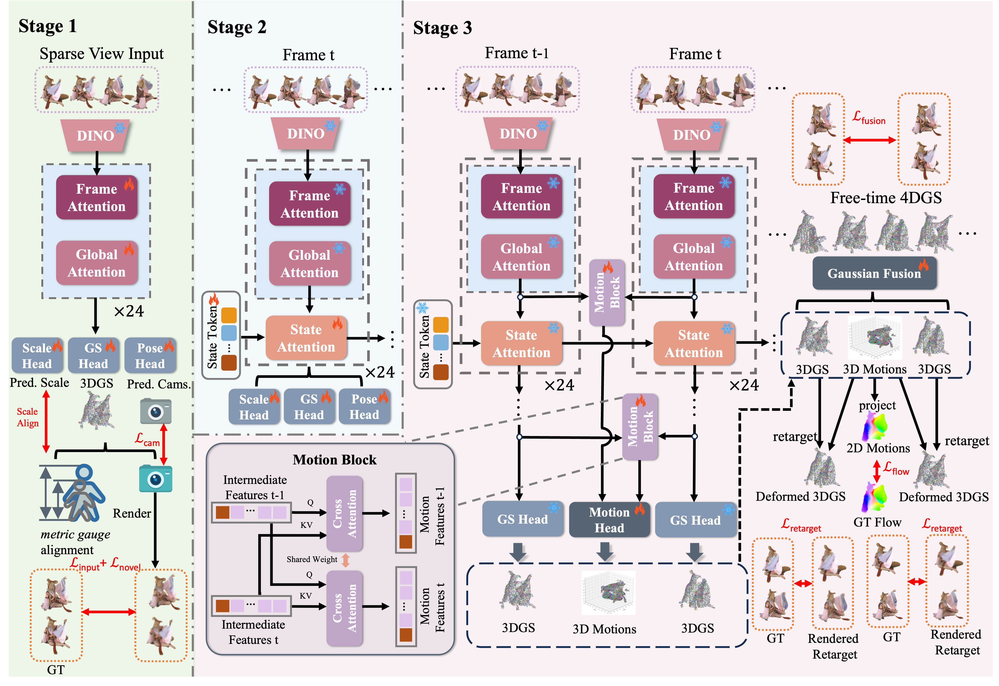

# Forge4D: Feed-Forward 4D Human Reconstruction and Interpolation from Uncalibrated Sparse Videos

[](https://arxiv.org/abs/2509.24209)
[](https://zhenliuzju.github.io/huyingdong/Forge4D)

[Yingdong Hu](https://zhenliuzju.github.io/huyingdong/),
[Yisheng He](https://hyshkust.github.io/),
[Jinnan Chen](https://jinnan-chen.github.io/),
[Weihao Yuan](https://weihao-yuan.com/),
[Kejie Qiu](https://sites.google.com/site/kejieqiujack/home),
[Zehong Lin](https://zhlinup.github.io/),
[Siyu Zhu](https://sites.google.com/site/zhusiyucs/home),
[Zilong Dong](https://scholar.google.com/citations?user=GHOQKCwAAAAJ&hl=zh-CN&oi=ao),
[Jun Zhang](https://eejzhang.people.ust.hk/)

<div align="center">

</div>

Forge4D is a feed-forward approach for 4D human reconstruction and interpolation from uncalibrated sparse-view videos. It reconstructs dynamic 3D humans with Gaussian Splatting in a single forward pass without per-scene optimization.

## News

- [x] Release inference code
- [ ] Release pretrained checkpoint (expected around ~May 7)
- [ ] Release training code (expected around ~May 7)

## Installation

```bash
# Clone the repository
git clone https://github.com/yourusername/Forge4D.git
cd Forge4D

# Install dependencies
pip install -r requirements.txt

# Install Forge4D in development mode
pip install -e .
```

### Requirements

- Python >= 3.10
- CUDA-capable GPU with at least 24GB memory
- PyTorch >= 2.0
- gsplat (for 3D Gaussian Splatting rasterization)

## Quick Start

### Download Pretrained Model

Download the pretrained checkpoint from [Hugging Face](https://huggingface.co/) (link coming soon).

### Prepare Data

Download the [DNA-Rendering](https://dna-rendering.github.io/) dataset and organize it as:

```
/path/to/data/
  DNA-Rendering/
    main/
      {subject_id}/
        Cam{00-47}/
          {timestamp:04d}.jpg
          mask/
            {timestamp:04d}.png
        calibration_full.json
```

### Run Inference

```bash
python tools/inference.py \
    --weight /path/to/checkpoint.pth \
    --data_root /path/to/data \
    --output_dir ./output \
    --test_ids 0007_04 \
    --frames 50
```

### Configuration

Edit `config/inference_DNA.yaml` to configure dataset paths and model parameters:

```yaml
name: 'inference'
dataname: ['DNA']
dataset:
  train_view_num: 4
  resolution: 518
  data_root: '/path/to/your/data'
  bg_color: [0., 0., 0.]
```

## Project Structure

```
Forge4D/
├── forge4d/               # Core model package
│   ├── layers/            # Transformer layers (attention, MLP, RoPE, etc.)
│   ├── models/            # Model definitions (VGGT, aggregator)
│   ├── heads/             # Prediction heads (camera, DPT, tracking)
│   └── utils/             # Utilities (pose encoding, geometry, rotation)
├── lib/                   # Shared utilities
│   ├── GaussianRender.py  # 3D Gaussian Splatting rendering
│   ├── dna_dataset.py     # DNA-Rendering dataset loader
│   ├── loss.py            # Training losses
│   ├── flow.py            # Optical flow utilities
│   └── utils.py           # General utilities
├── gaussian_renderer/     # 3DGS rasterization wrapper
├── config/                # Configuration files
├── tools/                 # Inference scripts
└── assets/                # Teaser images
```

## Citation

```bibtex
@misc{hu2025forge4dfeedforward4dhuman,
    title={Forge4D: Feed-Forward 4D Human Reconstruction and Interpolation from Uncalibrated Sparse-view Videos},
    author={Yingdong Hu and Yisheng He and Jinnan Chen and Weihao Yuan and Kejie Qiu and Zehong Lin and Siyu Zhu and Zilong Dong and Jun Zhang},
    year={2025},
    eprint={2509.24209},
    archivePrefix={arXiv},
    primaryClass={cs.CV},
    url={https://arxiv.org/abs/2509.24209},
}
```

## License

This project is licensed under the Apache License 2.0 - see the [LICENSE](LICENSE) file for details.

Some components include code derived from:
- [DINOv2](https://github.com/facebookresearch/dinov2) (Apache 2.0)
- [3D Gaussian Splatting](https://github.com/graphdeco-inria/gaussian-splatting) (non-commercial research license)
- [gsplat](https://github.com/nerfstudio-project/gsplat)

## Acknowledgements

This codebase builds upon the [VGGT](https://github.com/facebookresearch/vggt) architecture. We thank the authors for their open-source contributions.
